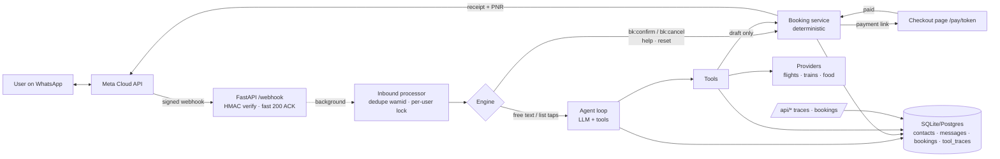

# WhatsApp Personal AI Agent

A personal assistant that lives in WhatsApp and **gets tasks done**: book flights, book trains and order
food, all by chatting in plain English, Hindi or Hinglish. It's built on the official **Meta WhatsApp Cloud API**,
with a **pluggable LLM (Gemini, Groq or OpenRouter)** as a tool-using agent and a **human-in-the-loop checkout**, so the AI can never spend money by itself.

```
You:    cheapest flight delhi to goa next friday evening
Agent:  Found 5 ✈️ Cheapest is *IndiGo 6E-412, 18:05 → 20:35, ₹4,280* (non-stop). Tap to pick 👇
        [View flights ▾]                          ← WhatsApp list message
You:    (taps IndiGo ₹4,280)
Agent:  I just need the passenger's full name, age and gender.
You:    Dhruv Pandey, 24, male                    ← saved to profile, never asked again
Agent:  ✈️ IndiGo 6E-412 DEL→GOI … 👤 Dhruv Pandey (24M)  *Total ₹4,280*
        [✅ Confirm & pay] [❌ Cancel]              ← reply buttons, handled in code, not by the LLM
You:    (taps Confirm)
Agent:  🔒 Tap below to pay securely  [Pay ₹4,280]  ← CTA URL button → checkout page
        (user pays on the page)
Agent:  🎉 Payment received: ₹4,280 · PNR: *QKZTRM*
```

## What it does

| Service | Capabilities |
|---|---|
| ✈️ **Flights** | Search by city or IATA code, with date, adults, sort (cheapest / earliest / fastest) and a departure time window |
| 🚆 **Trains** | IRCTC-style search with per-class fares (1A/2A/3A/CC/SL) and live-looking availability or waitlist. Waitlisted classes can't be booked. 10-digit PNR |
| 🍔 **Food** | Find restaurants by dish or cuisine, veg-only filter, menus, multi-item cart, delivery fee and taxes, saved address |
| 🧠 **Memory** | Long-term **profile** (name, age, gender, address, preferences) saved automatically, so "book the same for me" works. Short-term chat history per user |
| 📋 **Manage** | "show my bookings", "cancel FL-7K2Q9A" (refund shown). Paid food orders can't be cancelled |

## Architecture



**Agent loop** (`app/agent/agent.py`): user text → the LLM picks tools → results go back to it → repeat (max 8 steps)
→ final reply. Search tools also queue **native WhatsApp list messages**, so the user taps instead of typing.
Tool errors (unknown city, missing address, spend limit) go back to the model as `is_error` results, and it
recovers by asking the user.

### Safety: the LLM can't spend money
1. `prepare_booking` only creates a **draft**. It sends Confirm/Cancel buttons and says so to the model.
2. **Confirm** is a WhatsApp button handled in plain code. The LLM isn't in that path, so a hallucination or a
   prompt injection ("yes, confirm it") can't commit anything.
3. The **user pays on the checkout page themselves**. The payment link is an unguessable token, expires after
   15 minutes, and paying is idempotent.
4. Guardrails: a **per-order spend limit** (`MAX_ORDER_AMOUNT`), **ownership checks** on every booking id that
   comes from a button payload, one open draft at a time (a stale Confirm button is rejected), and waitlisted
   train classes can't be booked.

### Production-grade WhatsApp plumbing
HMAC-SHA256 signature check on webhooks · immediate ACK with background processing · **idempotency** on
`wamid` (Meta retries deliveries) · per-user ordering lock · retries with backoff on 429/5xx · respects the
24-hour customer-service window · delivery status tracking · **mock mode**, so everything runs without Meta.

### Observability
Every tool call is stored in `tool_traces` (input, output, error, latency):
`GET /api/traces?wa_id=91…` shows exactly what the agent did and why. `GET /api/bookings` shows all orders.

## What's real vs mocked (MVP)

| Part | Status | How to go live |
|---|---|---|
| WhatsApp messaging, lists, buttons, CTA links | **Real** (Meta Cloud API) | Already live with your test number |
| AI agent, tool use, memory | **Real** (Gemini / Groq / OpenRouter) | Switch with `LLM_PROVIDER` |
| Flight inventory | Mock, deterministic | Implement `FlightProvider` with Amadeus / Duffel / TBO |
| Train inventory | Mock | IRCTC has no public API, so this needs an authorised agent (B2B) API |
| Food | Mock | ONDC buyer app or a restaurant partner API |
| Payment | Test checkout page | Swap for a Razorpay Payment Link and call `mark_paid` from its signed webhook |

Each provider sits behind an interface (`app/providers/base.py`), so going live means writing **one class**.
The agent, tools and checkout flow don't change.

## Run it

```bash
python -m venv .venv && .venv\Scripts\activate      # Windows
pip install -r requirements-dev.txt
copy .env.example .env                                # set LLM_PROVIDER + LLM_API_KEY (+ Meta creds for live)
uvicorn app.main:app --reload
```

**Without a phone**, use the terminal simulator. It sends correctly signed webhooks, and you type a number to tap a list or button option:
```bash
python scripts/simulate.py --name "Dhruv"
```

**On real WhatsApp** (Meta test number):
1. `ngrok http 8000`, then set `PUBLIC_BASE_URL=https://<id>.ngrok-free.app` in `.env` and restart.
2. Meta App → WhatsApp → Configuration → Webhook: URL `https://<id>.ngrok-free.app/webhook`, verify token
   = `WHATSAPP_VERIFY_TOKEN`, then subscribe to **messages**.
3. Message the test number from a phone you added as a recipient.

**Tests** (offline, with a scripted LLM, so they're deterministic): `pytest`. They cover the full flight / train / food
flows end to end through signed webhooks, the checkout, the spend limit, ownership, stale drafts, tool-error recovery
and memory trimming.

## Switching LLM provider
All three providers expose an OpenAI-compatible API, so a single adapter (`app/agent/llm.py`) covers them. Only `.env` changes:

| `LLM_PROVIDER` | Get a key | Default `LLM_MODEL` |
|---|---|---|
| `gemini` | aistudio.google.com/apikey (free tier) | `gemini-3-flash-preview` |
| `groq` | console.groq.com/keys (free tier, very fast) | `llama-3.3-70b-versatile` |
| `openrouter` | openrouter.ai/keys (any model) | `google/gemini-2.5-flash` |

Set `LLM_MODEL` to use any other tool-calling model from that provider. Set `LLM_BASE_URL` to point at another
OpenAI-compatible endpoint (for example a local Ollama).

## Project layout
```
app/
  agent/    agent.py (loop + memory) · llm.py (Gemini/Groq/OpenRouter adapter) · tools.py (tool schemas + impls) · engine.py (routing)
  providers/ base.py (interfaces) · mock.py (flights, trains, food)
  services/ bookings.py (lifecycle, guardrails) · messaging.py (24h window, persistence) · inbound.py
  api/      webhook.py · pay.py (checkout) · admin.py (traces, bookings)
  whatsapp/ client.py (Cloud API + message builders) · parser.py
scripts/simulate.py · tests/
```

## Next steps
Real providers (above) · voice notes via speech-to-text · price-drop alerts (a background job plus an approved template
message) · round trips and multi-city · Redis lock and a queue for multi-instance scale · Postgres.
